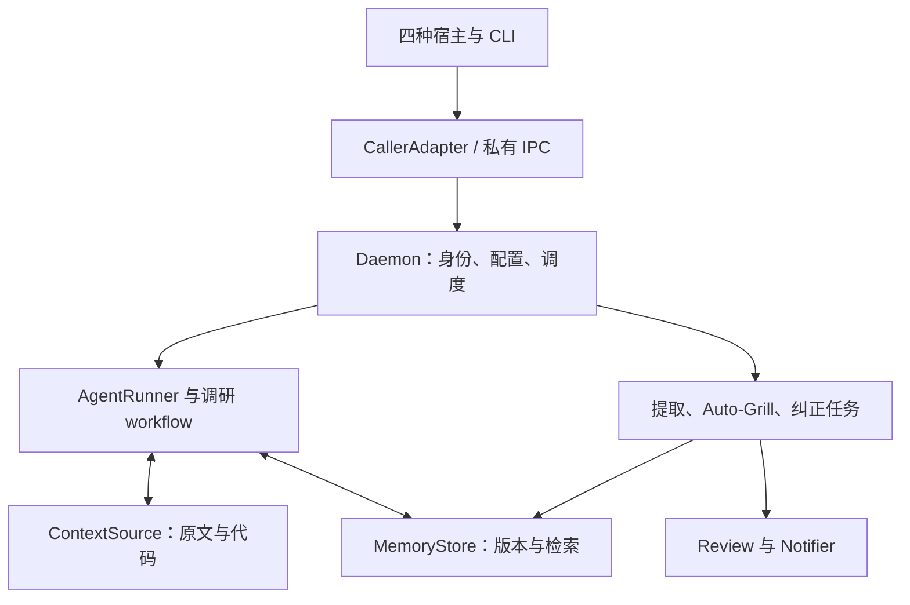

# 02｜总体架构、模块边界与 CLI 契约

Source: [Notion](https://app.notion.com/p/40117b41f58c8172a233d5ed87b5fdba?pvs=204) · Specification v0.1 · Captured 2026-10-22

所属规格：[跨 Agent 记忆系统｜MVP 开发规格与 Issue 计划](https://app.notion.com/p/40117b41f58c81acb9f3e88ffe51e135)

## 架构决定

采用本地 daemon 统一持有存储 writer、任务队列、共享缓存和配置管理。CLI 是薄客户端；宿主适配器负责识别调用现场、接入宿主和执行协议。外部调研与编辑 Agent 通过受限工具接口访问资料，不直接操作数据库文件。



## 接口职责

| 接口 | 输入与输出 | 必须遵守 |
| --- | --- | --- |
| CallerAdapter / ContextSource | 宿主事件 → InvocationContext；分段历史、代码和覆盖范围 | 身份不能猜；遵守分支和截止位置；原文不可由摘要替代 |
| AgentRunner | AgentRunSpec → 事件流/最终结果/明确错误 | 声明能力；可取消；共享预算；不强迫固定模型组合 |
| MemoryStore | 修订提交、head、as-of、receipt、检索 | 事务边界明确；持久确认；并发修订冲突检测 |
| OutcomeSource | 测试/运行/人工纠正 → OutcomeEvent | 区分正常非零退出与真实异常；关联证据不直接宣判因果 |
| Notifier | DeliveryRequest → 投递结果和外部引用 | 持久 outbox 驱动；幂等；通知失败不阻塞记忆业务 |

建议模块：domain、store、context、runner、research、knowledge、review、notify、config、ipc。实现时只在独立构建、依赖隔离或测试需要时拆 crate，不要求一模块一 crate。

## 拟议 CLI

```bash
mem init
mem daemon start
mem doctor --json
mem connect claude
mem connect codex
mem connect hermes
mem connect pi

mem consult
mem consult "核对这个修改是否违背过去的决定"

mem config validate
mem config reload
mem config status --json
mem config show --effective

mem memory show <id>
mem memory history <id>
mem state show --at <commit>
mem state diff <commit-a> <commit-b>
mem receipt show <receipt-id>
mem patch validate <patch-file>
mem patch apply <patch-file>
mem review list
mem review show <review-id>
mem review resolve <review-id>
mem import mempal <source>
mem export <destination>
mem backup create <destination>
mem backup verify <backup>
mem backup restore <backup>
```

这些命令定义功能语义；最终 CLI 名称和少量 flag 可在实现时统一，但必须同步文档与宿主 shim。调用主 Agent 的默认工具入口只暴露 consult 的短接口，不预加载整个管理 API 的 schema。

## IPC 与错误

- Linux 默认 Unix domain socket，运行目录和 socket 使用用户级访问控制；不默认监听 TCP。
- 连接握手包含协议版本、功能能力和最大消息尺寸。用户可见 CLI 参数与内部 InvocationContext 分开。
- 请求含 request\_id、幂等键、deadline/cancellation 关联；事件流有顺序号。内容较大时传磁盘对象引用，不复制成无限大的 IPC 消息。
- 错误至少区分 BINDING\_UNAVAILABLE、HISTORY\_PARTIAL、CONFIG\_INVALID、CONFIG\_RESTART\_REQUIRED、REVISION\_CONFLICT、RESOURCE\_BUSY、DISK\_FULL、PROVIDER\_TIMEOUT、RUNNER\_TIMEOUT、CANCELLED。
- 超时、空结果、资料不足与“不存在相关记忆”不是同一结果。不得伪装成功。
- stdout 的模型可见结果只包含最终有用信息；daemon 日志不自动回流调用方。管理命令可以提供明确的机器可读输出。

## 外部插件协议

内部使用 Rust trait；外部使用版本化 JSONL over stdio。插件握手报告 protocol\_version、capabilities 和实现版本。统一 request/result/error/cancel 语义；stderr 可记录诊断，但适配器必须截留不必要日志。

MVP 至少交付一个真实 stdio Notifier 示例和 runner/context 契约测试工具。不得仅给接口定义而没有可运行示例；也不要求建立通用插件商店。

## 写操作边界

查询 worker 默认只读，允许 history/read-code/search/get-memory/delegate-context 等有限能力。editor 经策略授权可提交修订；提交时重新检查当前权限、当前记忆版本和证据。worker 自己的会话不能替代 origin\_invocation。

配置 reload、取消、权限收缩和全局资源限制由程序执行，不能交给模型自行承诺。原始审计记录通过 API 追加，普通 editor 不提供改写原文能力。

## 长任务与宿主限制

本地调用允许长时间运行。宿主本身无法维持长工具执行时，适配器应采用异步任务句柄、宿主原生等待/完成事件或受控 runner，后台任务不因为前端连接结束而自动误判成功。

不得让主 Agent 以每几秒一次工具调用的方式忙轮询。无论同步还是异步，最终结果只返回一次，用户取消可传播到后台任务树。

## 迁移方式

mempal 的源代码和数据通过单独迁移 Issue 审查。只有满足当前 REQ 的能力才移植；任何复制的代码保留适用的许可证和来源信息。旧 prompt、路径约定、模型组合和权限设计不得因为“原来如此”自动继承。
